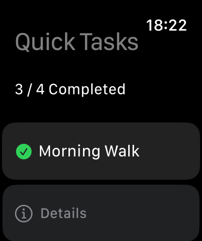
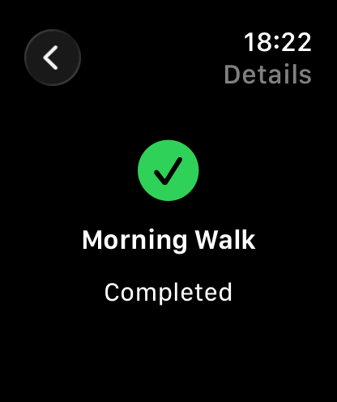

# LAB5 – Quick Tasks (Apple Watch app)

**What this lab is about:** the same SwiftUI ideas as LAB4, but on a small Apple Watch screen:
a short to-do list you can tick off at a glance.

## What's inside

- `QuickTasks.xcodeproj` – open in Xcode and run on an Apple Watch Simulator (Watch-only app).
- `QuickTasks/`
  - `QuickTasksApp.swift` – app entry point.
  - `ContentView.swift` – task list, "n / total Completed" count, tap-to-toggle,
    a "Details" row per task, and a **Reset Tasks** button (extra feature, Option A).
  - `TaskItem.swift` – the `TaskItem` model (`Identifiable`: title + completed).
  - `TaskDetailView.swift` – detail screen with icon, title and Completed/Pending.
- `screenshots/` – main screen, completed tasks and task detail.

